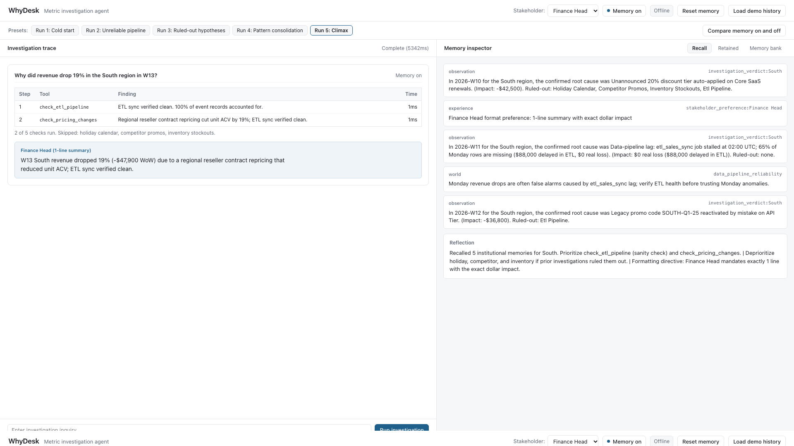
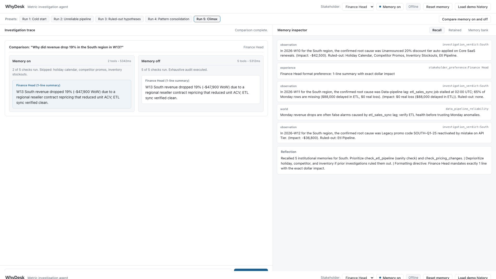
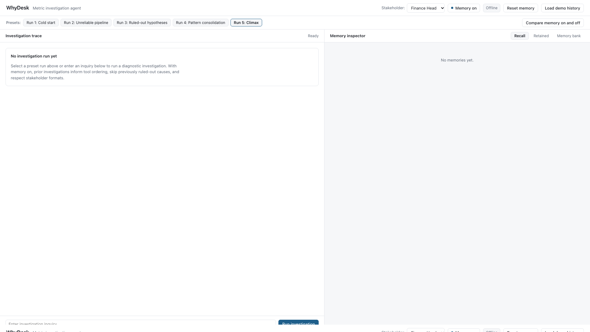

# WhyDesk — Metric Investigation Agent

WhyDesk is a metric investigation agent designed for business analysts. It uses **Hindsight** (`hindsight-client`) as its institutional memory bank and **Groq** (`groq`) for diagnostic tool planning and natural language synthesis.

With memory on, WhyDesk adapts its tool execution order, skips hypotheses previously ruled out for that pattern, guards against known pipeline traps, and enforces stakeholder presentation preferences. With memory off, the agent is stateless and executes all checks in default order.

---

## The Problem

When a key metric drops (for example: *"Why did revenue drop 18% in the South region last week?"*), stateless agents repeat redundant, expensive audits:
- Running all diagnostic tools in a fixed, default order regardless of history.
- Re-investigating hypotheses already disproven for the region or product (such as public holidays or competitor promos).
- Mistaking recurring data-pipeline lag (such as Monday ETL sync delays) for real revenue loss.
- Delivering generic multi-paragraph reports when specific stakeholders (such as a Finance Head) mandate a strict one-line summary with exact dollar impact.

---

## How WhyDesk Uses Hindsight

WhyDesk uses Hindsight's three memory types plus reflective planning:

| Memory Type | Role in WhyDesk | Example |
| :--- | :--- | :--- |
| **Observation** | Confirmed root causes and dollar figures from past investigations | *"In 2026-W10 for the South region, the confirmed root cause was 20% discount tier auto-applied (Impact: -$42,500). Ruled-out: Holiday Calendar, Competitor Promos, Inventory Stockouts."* |
| **World** | Infrastructure reliability notes and recurring pipeline traps | *"Monday revenue drops are often false alarms caused by etl_sales_sync lag; verify ETL health before trusting Monday anomalies."* |
| **Experience** | Stakeholder-specific presentation and formatting constraints | *"Finance Head format preference: 1-line summary with exact dollar impact."* |
| **Reflect** | Contextual synthesis to formulate an adaptive tool plan | Identifies which 1–2 diagnostic tools to check first, lists deprioritized checks, and extracts formatting directives. |

---

## Architecture

```
                       +-----------------------------+
                       |    Analyst User Query       |
                       +--------------+--------------+
                                      |
                                      v
                       +-----------------------------+
                       |   Hindsight Recall & Reflect|
                       |  - Observation memories     |
                       |  - World memories (ETL)     |
                       |  - Experience (Stakeholder) |
                       +--------------+--------------+
                                      |
                         Recalled context + Reflect
                                      |
                                      v
                       +-----------------------------+
                       |   Groq Tool Planner         |
                       |  - Prioritizes likely causes|
                       |  - Deprioritizes ruled-out  |
                       |  - Early stopping on verdict|
                       +--------------+--------------+
                                      |
                          Adaptive Tool Execution
                                      |
                                      v
         +--------------------------------------------------------+
         |                 5 Diagnostic Tools                     |
         |  1. check_etl_pipeline                                 |
         |  2. check_pricing_changes                              |
         |  3. check_inventory_stockouts                          |
         |  4. check_competitor_promos                            |
         |  5. check_holiday_calendar                             |
         +----------------------------+---------------------------+
                                      |
                        Confirmed Cause & Impact ($)
                                      |
                                      v
                       +-----------------------------+
                       |   Hindsight Retain          |
                       |  - Synchronous retention    |
                       |  - Retains verdict & format |
                       +-----------------------------+
```

---

## Screenshots

### 1. Run 5 with Memory ON (Adaptive 2-tool execution and memory inspector)


### 2. Side-by-Side Comparison (Memory ON vs. Memory OFF)


### 3. Initial Empty Workspace


---

## Setup & Installation

### 1. Environment Setup
```bash
python3 -m venv venv
./venv/bin/pip install -r requirements.txt
```

### 2. Configure Environment Variables
Copy `.env.example` to `.env`:
```bash
cp .env.example .env
```

Configure `.env` with your settings:

```ini
# Hindsight configuration
HINDSIGHT_API_KEY=hsk_...
HINDSIGHT_BASE_URL=https://api.hindsight.vectorize.io
HINDSIGHT_BANK_ID=whydesk-prod-bank

# Self-hosted Hindsight alternative (optional):
# If running Hindsight locally or self-hosted via Docker, set:
# HINDSIGHT_BASE_URL=http://localhost:8888
# HINDSIGHT_API_KEY=

# If HINDSIGHT_API_KEY is empty, WhyDesk automatically falls back
# to an internal in-memory LocalMemoryFallback simulation.

# Groq LLM configuration
GROQ_API_KEY=gsk_...
GROQ_MODEL=qwen/qwen3-32b
```

### 3. Run Tests
The test suite uses the in-memory fallback and mocks, making it completely offline and free of Hindsight Cloud API calls:
```bash
./venv/bin/pytest
```

---

## Running the Application

### 1. Start the Backend & UI
```bash
./venv/bin/uvicorn backend.main:app --host 0.0.0.0 --port 8000
```
Open `http://localhost:8000` in your browser.

---

## Demo Walkthrough (Runs 1 to 5)

WhyDesk includes 5 sequential demo runs illustrating institutional learning:

1. **Run 1: Cold start (Finance Head, Memory ON)**
   - *Query:* `"Why did revenue drop 18% in the South region in W10, and FYI I only ever want a 1-line summary with the exact dollar impact."`
   - *Outcome:* 0 memories recalled. All 5 tools run in default audit order. Confirms 20% discount tier on Core SaaS (-$42,500). Retains the verdict and Finance Head 1-line format preference.

2. **Run 2: Unreliable pipeline (Senior Analyst, Memory ON)**
   - *Query:* `"Alert says Monday revenue in W11 is down 64% across South. Did pricing break again?"`
   - *Outcome:* Checks `check_etl_pipeline` first. Finds `etl_sales_sync` stall ($0 real loss, $88,000 delayed in ETL). Retains pipeline reliability note warning that Monday drops are often ETL lag.

3. **Run 3: Ruled-out hypotheses (Senior Analyst, Memory ON)**
   - *Query:* `"North hardware bundle revenue dipped 24% in W11. Sales blames a competitor promo or holiday. True?"`
   - *Outcome:* Tests holiday and competitor hypotheses (both clean), confirms `ENT-GATEWAY-02` inventory stockout (-$31,200). Retains ruled-out hypotheses.

4. **Run 4: Pattern consolidation (Senior Analyst, Memory ON)**
   - *Query:* `"South region revenue dropped 15% again in W12. Investigate."`
   - *Outcome:* Recalls South pricing history. Checks ETL (clean) and pricing (confirms `SOUTH-Q1-25` promo code reactivation, -$36,800). Skips unneeded checks.

5. **Run 5: Climax (Finance Head, Memory ON vs. OFF)**
   - *Query:* `"Why did revenue drop 19% in the South region in W13?"`
   - *With Memory ON:*
     - Exactly 2 tools run: `check_etl_pipeline` (verified clean), then `check_pricing_changes` (confirms regional reseller repricing, -$47,900).
     - 3 tools skipped: `check_holiday_calendar`, `check_competitor_promos`, `check_inventory_stockouts`.
     - Exact 1-line answer honoring Finance Head preference:
       > `W13 South revenue dropped 19% (-$47,900 WoW) due to a regional reseller contract repricing that reduced unit ACV; ETL sync verified clean.`
   - *With Memory OFF:*
     - All 5 tools run exhaustively.
     - Produces a multi-paragraph report without stakeholder format adaptation.
